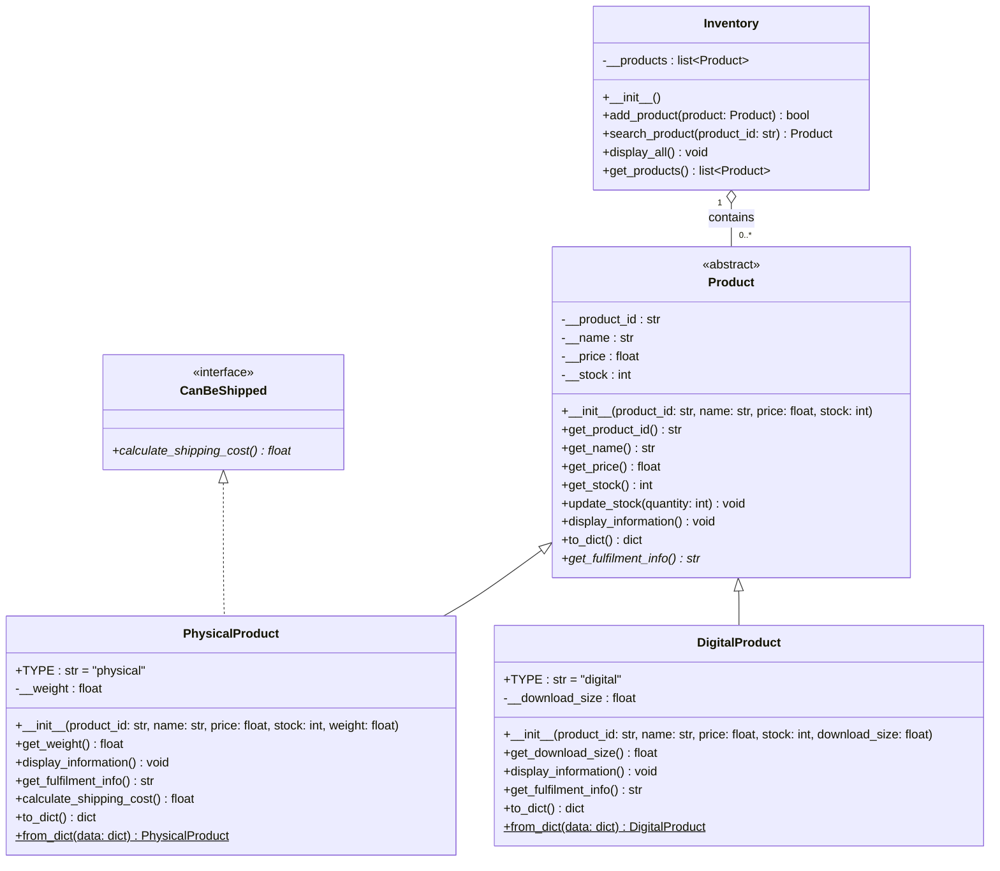

# INF1103 DevOps Labs

Weekly lab work for **INF1103 – DevOps** at the Singapore Institute of Technology (BEng (Hons) ICT, Software Engineering).

The main project is a command-line **Inventory Management System** written in Python using object-oriented design. Earlier labs, which build up to it, are kept in [`earlier-labs/`](earlier-labs/).

## Inventory Management System

A menu-driven app to view, add, search and update products, with data saved to JSON.

**Features**
- Two product types: **physical** (has weight, can be shipped) and **digital** (has download size)
- Shipping cost for physical products (flat fee + rate per kg)
- Input validation on every field
- Inventory loads from and saves to `data/inventory.json`

### Design

| File | Responsibility |
|------|----------------|
| `product.py` | `Product` – abstract base class with encapsulated common fields |
| `physical_product.py` | `PhysicalProduct` – extends `Product`, implements `CanBeShipped` |
| `digital_product.py` | `DigitalProduct` – extends `Product` |
| `can_be_shipped.py` | `CanBeShipped` – interface (abstract base class) for shippable items |
| `inventory.py` | `Inventory` – manages the collection of products |
| `file_handler.py` | Loads/saves the inventory as JSON |
| `oop_inventory_system.py` | Entry point and menu |



OOP concepts used: abstraction, encapsulation (private attributes with getters), inheritance, polymorphism and an interface-style ABC.

### Run it

With Python 3.10+:

```bash
python oop_inventory_system.py
```

With Docker:

```bash
docker build -t inventory-system .
docker run -it inventory-system
```

## Earlier labs

| Folder | What it covers |
|--------|----------------|
| `01-hello-profile` | Variables, input and conditionals |
| `02-stock-auditor` | Loops and input validation |
| `03-modular-auditor` | Breaking a program into functions |
| `04-persistent-auditor` | Reading and writing text files |
| `05-json-inventory-auditor` | JSON persistence for an inventory |
